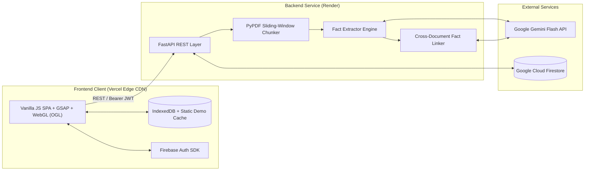

<div align="center">

# SYNAPTICA

**AI-Powered Evidence-Grounded Fact Knowledge Layer**

[](https://synaptica-green.vercel.app/)
[](https://synaptica-7ha3.onrender.com/api/health)
[](https://github.com/m4n1kya/Synaptica/actions)
[](LICENSE)

<p align="center">
  <a href="#overview">Overview</a> •
  <a href="#key-capabilities">Key Capabilities</a> •
  <a href="#system-architecture">Architecture</a> •
  <a href="#tech-stack">Tech Stack</a> •
  <a href="#project-structure">Project Structure</a> •
  <a href="#getting-started">Getting Started</a> •
  <a href="#api-reference">API Reference</a>
</p>

</div>

---

## Overview

**Synaptica** transforms scattered, unstructured PDF documents into a connected, verifiable knowledge layer. Instead of treating documents as isolated text blobs or generating ungrounded summaries, Synaptica decomposes source material into **atomic facts**—each anchored to exact page numbers, verbatim evidence quotes, confidence scores, and contextual metadata (time period, scope, and methodology).

Across multiple documents, Synaptica autonomously links related claims and classifies their epistemic relationships: identifying where independent sources **corroborate** each other, where they **contradict**, and where apparent discrepancies are explained by **contextual differences** (e.g., WPI vs. CPI inflation, or FY24 vs. Q4 FY24 metrics).

---

## Key Capabilities

- **Evidence-Grounded Fact Extraction** — Ingests multi-page PDFs via sliding-window page chunking and extracts structured claims with verbatim quotes, numerical values, units, and page citations.
- **Cross-Document Epistemic Linking** — Pairs candidate facts across documents by semantic category and numerical proximity, using LLM reasoning traces to classify relationships into:
  - `corroborates` — Independent confirmation of the same underlying claim.
  - `contradicts` — Irreconcilable divergence on the same metric, scope, and timeframe.
  - `contextual_difference` — Divergent figures reconciled by differing methodologies, scopes, or reporting periods.
- **Source × Category Pivot Matrix** — High-density cross-tabulation view mapping every ingested document against extracted domain categories for rapid comparative auditing.
- **Interactive Force-Directed Knowledge Graph** — Custom HTML5 Canvas physics simulation visualizing documents and facts as nodes connected by color-coded relationship edges.
- **Hybrid Multi-Tenant & Local-First Storage** —
  - **Authenticated Workspace**: Google OAuth & Email/Password authentication backed by **Google Cloud Firestore** for isolated, persistent user workspaces.
  - **Zero-Latency Guest Mode**: Pre-computed static dataset (`demo.json`) paired with browser **IndexedDB** persistence for instant exploration and guest PDF uploads.

---

## System Architecture



---

## Tech Stack

| Layer | Technology | Purpose |
| :--- | :--- | :--- |
| **Frontend UI** | HTML5, CSS3, Vanilla JavaScript (ES6+) | Zero-framework SPA with custom glassmorphic design system |
| **Visuals & Motion** | WebGL2 (`ogl`), GSAP 3, HTML5 Canvas, Chart.js | Interactive shader hero (`PatternWaves`), physics graph, and telemetry |
| **Backend API** | Python 3.10+, FastAPI, Uvicorn, Pydantic v2 | Asynchronous REST endpoints, schema validation, and OpenAPI docs |
| **Document & AI Pipeline** | `pypdf`, `google-genai` (Gemini Flash) | Multi-page PDF parsing, structured JSON extraction, and pairwise linking |
| **Auth & Persistence** | Firebase Authentication, Cloud Firestore, IndexedDB | Multi-tenant cloud persistence with client-side local fallback |
| **Infrastructure** | Vercel (Frontend), Render (Backend), GitHub Actions | Continuous deployment and automated Python linting CI |

---

## Project Structure

```text
Synaptica/
├── .github/
│   ├── workflows/ci.yml        # Automated Python syntax & flake8 CI pipeline
│   ├── ISSUE_TEMPLATE/         # Structured bug report templates
│   ├── CONTRIBUTING.md         # Contribution workflow guidelines
│   ├── CODE_OF_CONDUCT.md      # Community standards
│   └── SECURITY.md             # Vulnerability reporting policy
├── backend/
│   ├── main.py                 # FastAPI entrypoint, auth verification & routes
│   ├── models.py               # Pydantic data models (Fact, Relationship, Document, CaseStudy)
│   ├── pdf_processor.py        # PDF text extraction & page-aware chunking
│   ├── fact_extractor.py       # Gemini LLM fact extraction with retry backoff
│   ├── fact_linker.py          # Cross-document candidate pairing & reconciliation
│   ├── firestore_store.py      # Per-user Cloud Firestore CRUD operations
│   ├── knowledge_store.py      # In-memory store & static export utilities
│   ├── demo_data.py            # Curated macroeconomic & corporate benchmark datasets
│   └── requirements.txt        # Pinned Python dependencies
├── frontend/
│   ├── index.html              # Main application shell
│   ├── demo.json               # Pre-built benchmark dataset for instant guest loading
│   ├── css/                    # Modular stylesheet architecture (design-system, layout, components, hero)
│   └── js/                     # Modular ES6 controllers (app, api, storage, matrix, graph, upload, etc.)
├── .env.example                # Environment variable template
├── .gitignore                  # Git exclusion rules
├── LICENSE                     # MIT License
└── README.md                   # Project documentation
```

---

## Getting Started

### Prerequisites

- **Python** `3.10+`
- A **Google Gemini API Key** ([Google AI Studio](https://aistudio.google.com/))
- *(Optional)* Firebase project credentials for authenticated cloud persistence

### 1. Clone the Repository

```bash
git clone https://github.com/m4n1kya/Synaptica.git
cd Synaptica
```

### 2. Configure Environment Variables

Copy the example environment file and add your Gemini API key:

```bash
cp .env.example .env
```

Set `GEMINI_API_KEY` in your environment:

```bash
# Linux / macOS
export GEMINI_API_KEY="your_gemini_api_key"

# Windows (PowerShell)
$env:GEMINI_API_KEY="your_gemini_api_key"
```

### 3. Install Dependencies & Start the Server

```bash
cd backend
pip install -r requirements.txt
uvicorn main:app --reload --port 8000
```

FastAPI serves both the REST API and the static frontend locally:
- **Application UI**: `http://localhost:8000`
- **Interactive Swagger Docs**: `http://localhost:8000/docs`

### 4. Running Automated Tests & Coverage

Execute the automated test suite across all API contracts, Pydantic models, and ML pipelines:

```bash
pytest backend/tests -v --cov=backend --cov-report=term-missing
```

---

## API Reference

| Method | Endpoint | Auth | Description |
| :--- | :--- | :--- | :--- |
| `GET` | `/api/health` | Public | Service health check and runtime status |
| `GET` | `/api/stats` | Optional | Aggregated counts of documents, facts, categories, and relationships |
| `GET` | `/api/documents` | Optional | List all ingested documents (returns demo dataset if unauthenticated) |
| `GET` | `/api/documents/{doc_id}` | Optional | Retrieve detailed document metadata and extracted atomic facts |
| `DELETE` | `/api/documents/{doc_id}` | Required | Delete a document and cascade-remove its facts and relationships |
| `POST` | `/api/upload` | Optional | Upload a PDF, extract atomic facts via Gemini, and compute relationships |
| `GET` | `/api/facts` | Optional | Query facts with optional `category`, `doc_id`, `min_confidence`, `search`, `limit`, and `offset` |
| `GET` | `/api/categories` | Optional | Retrieve fact distribution counts grouped by category |
| `GET` | `/api/relationships` | Optional | Query cross-document relationships with optional `relationship_type`, `limit`, and `offset` |
| `GET` | `/api/cases` | Optional | Retrieve curated analytical case studies (Corroboration, Contradiction, etc.) |

---

## Analytical Benchmark Datasets

Synaptica ships with two pre-verified multi-document benchmark suites accessible immediately in **Demo Mode**:

1. **India Macroeconomy (FY2024–25)** — Cross-analyzes excerpts from the *India Economic Survey 2024–25*, *RBI Annual Report 2024–25*, and *IMF Article IV Consultation*, highlighting corroborated GDP figures, diverging growth forecasts, and WPI vs. CPI inflation methodology differences.
2. **Delhivery Corporate Filings** — Cross-analyzes the *2022 IPO Prospectus*, *FY24 Annual Report*, and *Q4 FY24 Earnings Presentation*, tracking revenue progression, network infrastructure expansion, and profitability turnarounds across filing periods.

---

## License

Distributed under the **MIT License**. See [`LICENSE`](LICENSE) for full details.
